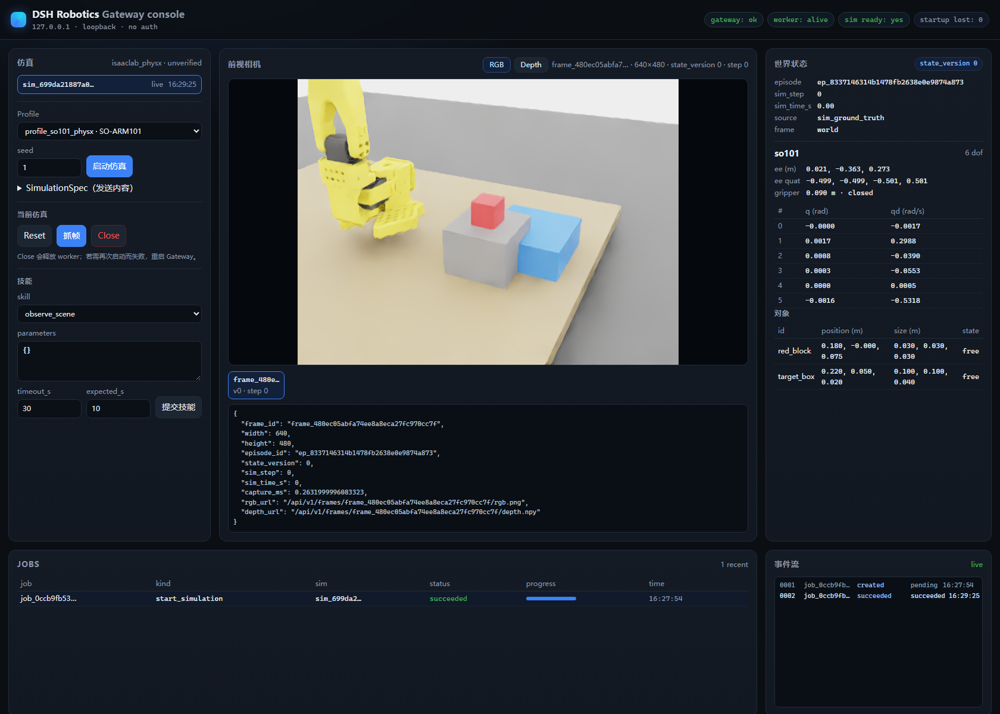

# DSH Robotics Sim

[中文文档](README.zh-CN.md)

DSH Robotics Sim is a research prototype for language-directed tabletop manipulation in Isaac Lab. A DeepSeek Harness (DSH) agent constructs a task plan from scene observations. The gateway checks the plan against the current simulation state, and a PhysX worker executes the selected skills and evaluates their physical outcomes. SO-ARM101 is the evaluation platform. A Franka profile is included for interface development.



*Gateway console during an SO-ARM101 run. The forward-facing virtual camera also provides [metric depth](artifacts/gui_2026-11-07/console-depth.png).*

## Method

| Component | Responsibility |
| --- | --- |
| [DSH plugin](packages/dsh-plugin) | Exposes tools for scene inspection, plan validation, execution, cancellation and frame retrieval. |
| [Gateway](python/robotics_gateway) | Validates typed requests, associates plans with scene snapshots, and persists job state and events in SQLite. |
| [Isaac Lab worker](python/robotics_backends/isaaclab_physx) | Advances PhysX, runs skills, captures RGB and depth, and measures task outcomes from simulator state. |

The grasp skill selects among six precomputed approach variants at 1 cm intervals along the x-axis. Joint position targets drive the approach, grasp, lift, transfer and release. The evaluation checks the object's final pose against the configured placement region. A cooperative control loop publishes state at 2 Hz and buffers camera frames at 1 Hz while a skill is running.

## Recorded task

**Instruction.** “Pick up the red block and place it on the target box.”

1. Start `profile_so101_physx` with seed 7. Create the task with `robotics_create_task` and inspect the scene with `robotics_inspect_scene`. The red block starts at approximately `(0.180, 0, 0.075) m`.
2. Validate a plan against state version 0 with `robotics_validate_plan`. For the recovery test, move the block about 4 mm along x using the development skill `move_object`. This advances the state version to 1.
3. Submit the original plan with `robotics_execute_task`. The gateway rejects it with `STALE_WORLD_STATE` before executing its motion.
4. Validate a revised plan against state version 1 and submit it. The job succeeds in 13.79 s. A final scene inspection reports the block at `(0.2326, 0.0586, 0.0550) m` and confirms it is in the target region. Close the simulation.

This sequence is a summary of the recorded tool calls. [Execution trace](artifacts/e_agent_analysis_2026-11-07/recovery.json)

## Evaluation

| Experiment | Observed result | Record |
| --- | --- | --- |
| Fixed-scene SO-ARM101 pick and place | 10/10 successes after correcting episode reset. The original run obtained 1/10. The acceptance threshold was held fixed. | [Protocol](docs/execution/eval_manifest.json), [results](artifacts/t09_2026-11-07_1435/summary.md) |
| Recovery and cancellation | Both injected failure cases recovered after replanning. Cancellation during a pick was acknowledged by the worker in 217 ms in the reported trial. | [Recovery and lifecycle tests](artifacts/t09_2026-11-07_1435/summary.md) |
| Camera output | 640 × 480 RGB and camera-axis depth in metres. Frames and metadata are available through the gateway. | [Camera evaluation](artifacts/t08_2026-11-07_1410/summary.md) |

The experiments used a single Windows workstation. Planning and verification use simulator ground truth. The RGB and depth outputs support inspection and logging. The tested task uses predefined grasp variants and a fixed placement location. Randomized-scene generalization, hardware transfer and learned visual control remain outside the reported evaluation.

## Reproduction

The tested system used Windows 11, an RTX 4060 Laptop GPU with 8 GiB of memory, Isaac Sim `6.0.1.0`, and Isaac Lab `v3.0.0-beta2.patch1` at commit `ffff603e` with local modifications. The worker used Python 3.12.10 and PyTorch `2.11.0+cu128`.

Install the gateway dependencies in a Python environment and supply the Isaac Lab interpreter when starting the service. Place the Franka, SO-ARM101 and material USD assets under `assets/isaac6/` using the documented directory layout. The repository distributes code and evaluation artifacts. Asset sources and terms are listed separately. [Third-party notices](THIRD_PARTY_NOTICES.md)

```text
assets/isaac6/FrankaPanda/franka.usd
assets/isaac6/RobotStudio/so101_new_calib/so101_new_calib.usd
assets/isaac6/Materials/...
```

```powershell
python -m pip install -r requirements.txt
$env:PYTHONPATH = (Resolve-Path .\python).Path
$env:DSH_ROBOTICS_WARP_CACHE = 'C:\path\to\writable_ascii_cache'
python -m robotics_gateway --host 127.0.0.1 --port 8714 `
  --db artifacts\gateway.db --worker isaac --device cuda:0 `
  --python 'C:\path\to\env_isaaclab\Scripts\python.exe'
```

Replace both example paths with local paths. Use a short, writable ASCII path for the Warp cache. The first camera startup may take longer while kernels and shaders compile. Open [the local console](http://127.0.0.1:8714/ui). Run the gateway on loopback because its local API has no authentication.

To connect DSH, link `packages/dsh-plugin` as the local package `@local/dsh-robotics` in the active profile and enable `include:dsh-robotics` through the plugin manager. The plugin defaults to `http://127.0.0.1:8714`. Set `DSH_ROBOTICS_GATEWAY` when using a different address. [Profile patch](packages/dsh-plugin/cordis.patch.yml)

```powershell
python -m unittest discover -s tests/unit -v
python -m unittest tests.integration.test_gateway_http -v
```

The [evaluation runner](scripts/agent_eval.py) uses [JSON task matrices](configs/agent_eval_tasks.json) and writes per-episode JSONL traces. See the [development record](docs/execution/PROGRESS.md) for implementation details, the policy adapter and the failure analysis.

## License

The project code is available under the [MIT License](LICENSE). See the [third-party notices](THIRD_PARTY_NOTICES.md) for external assets and dependencies.
