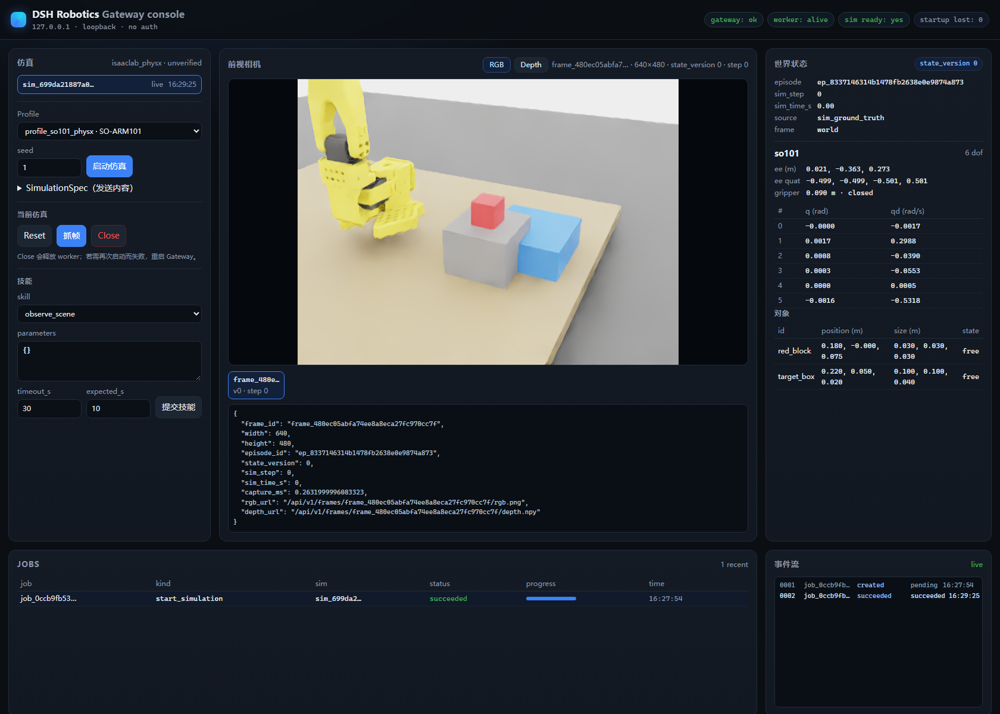

# DSH 机器人仿真

[English documentation](README.md)

本项目让 DeepSeek Harness（DSH）智能体能够观察和操作运行中的机器人仿真，主要面向视觉语言动作模型（VLA）的仿真工作流。VLA 策略生成机器人动作，Agent 观察执行过程、读取结果，并根据任务进展决定让策略继续运行、停止当前执行，或调用仿真技能接管任务。

当前后端为 Isaac Lab 与 PhysX。DSH 通过本地网关读取场景状态、相机帧和任务事件，也能发送执行与取消指令。后续可在同一套 DSH 工具接口下，为其他仿真软件编写后端适配器。



*控制台显示网关提供的场景、任务状态和相机数据。 [深度视图](artifacts/gui_2026-11-07/console-depth.png)*

## 从策略运行到 Agent 接管

| 阶段 | Agent 如何使用接口 |
| --- | --- |
| 观察执行 | 策略运行期间，用 `robotics_inspect_scene` 读取机器人与物体状态，用 `robotics_latest_frame` 获取最新画面，用 `robotics_get_job_events` 查看任务进展。 |
| 分析结果 | 结合失败码、场景状态和对应帧，判断执行结果是否满足目标。一次运行结束后，也可用同一批记录定位问题并提出重试方案。 |
| 介入执行 | 需要停止时，调用 `robotics_cancel_job`。等仿真进程确认当前任务已停止，再下发后续动作。 |
| 接管任务 | 重新读取场景，校验修订后的计划，再通过网关执行恢复技能或启动新一轮策略执行。网关在执行前检查计划所依据的场景状态。 |

当前原型具备运行中观测、取消确认以及计划校验与执行能力。策略适配器接收观测并返回一段动作序列，现阶段用脚本策略验证这条调用链。训练好的 VLA 模型是下一步接入对象。 [策略适配器](python/robotics_backends/isaaclab_physx/stub_policy.py)

## 任务示例：诊断一次抓空并重试

**任务。** 用 SO-ARM101 抓起红色积木，放到目标盒上。

1. 读取本轮报告和 `GRASP_MISSED` 对应的相机帧。场景中积木位于 `x ≈ 0.19 m`，抓取请求却指定了 `grasp_x = 0.16 m`。
2. 对照画面与参数。夹爪在积木旁边闭合，与 3 cm 的位置偏差一致。
3. 在同一场景中去掉强制抓取位置再试一次，由仿真进程根据实测块位置选择抓取变体。读取最终场景，确认积木已放到目标区域。

这个实例展示了如何利用仿真结果诊断和重试。另一份工具记录展示了场景变化后，网关拒绝旧计划以及 Agent 修订计划的过程。 [失败分析与重试](artifacts/e_agent_analysis_2026-11-07/analysis.md) · [重规划记录](artifacts/e_agent_analysis_2026-11-07/recovery.json)

SO-ARM101 和 Franka 场景用于在本机 Isaac 环境中验证接口。 [接口验证记录](docs/execution/PROGRESS.md)

## 复现

已验证环境为 Windows 11、RTX 4060 Laptop GPU（8 GiB）、Isaac Sim `6.0.1.0` 和带本地修改的 Isaac Lab `v3.0.0-beta2.patch1`（提交 `ffff603e`）。仿真进程使用 Python 3.12.10 与 PyTorch `2.11.0+cu128`。

在 Python 环境中安装网关依赖，启动时指定 Isaac Lab 的解释器。按目录约定在 `assets/isaac6/` 下准备 Franka、SO-ARM101 和材质 USD 资产。仓库提供代码与验收材料，资产来源和使用条款见[第三方说明](THIRD_PARTY_NOTICES.md)。

```text
assets/isaac6/FrankaPanda/franka.usd
assets/isaac6/RobotStudio/so101_new_calib/so101_new_calib.usd
assets/isaac6/Materials/...
```

```powershell
python -m pip install -r requirements.txt
$env:PYTHONPATH = (Resolve-Path .\python).Path
$env:DSH_ROBOTICS_WARP_CACHE = 'C:\path\to\writable_ascii_cache'
python -m robotics_gateway --host 127.0.0.1 --port 8714 `
  --db artifacts\gateway.db --worker isaac --device cuda:0 `
  --python 'C:\path\to\env_isaaclab\Scripts\python.exe'
```

将示例中的两个路径替换为本机路径。Warp 缓存使用短、可写的纯 ASCII 路径。首次启动相机可能需要编译内核与着色器。启动后打开[本地控制台](http://127.0.0.1:8714/ui)。网关接口无认证，运行时绑定到回环地址。

接入 DSH 时，把 `packages/dsh-plugin` 作为本地包 `@local/dsh-robotics` 链接到当前配置，再通过插件管理器启用 `include:dsh-robotics`。插件默认连接 `http://127.0.0.1:8714`，使用其他地址时设置 `DSH_ROBOTICS_GATEWAY`。 [配置补丁](packages/dsh-plugin/cordis.patch.yml)

```powershell
python -m unittest discover -s tests/unit -v
python -m unittest tests.integration.test_gateway_http -v
```

[评估脚本](scripts/agent_eval.py)读取 [JSON 任务矩阵](configs/agent_eval_tasks.json)，并输出逐轮 JSONL 轨迹。实现细节、策略接入和故障分析见[开发记录](docs/execution/PROGRESS.md)。

## 许可证

项目代码采用 [MIT 许可证](LICENSE)。外部资产与依赖见[第三方说明](THIRD_PARTY_NOTICES.md)。
